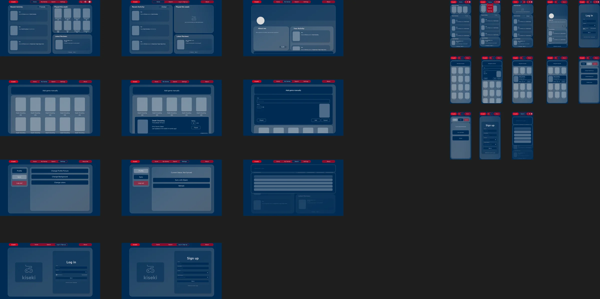
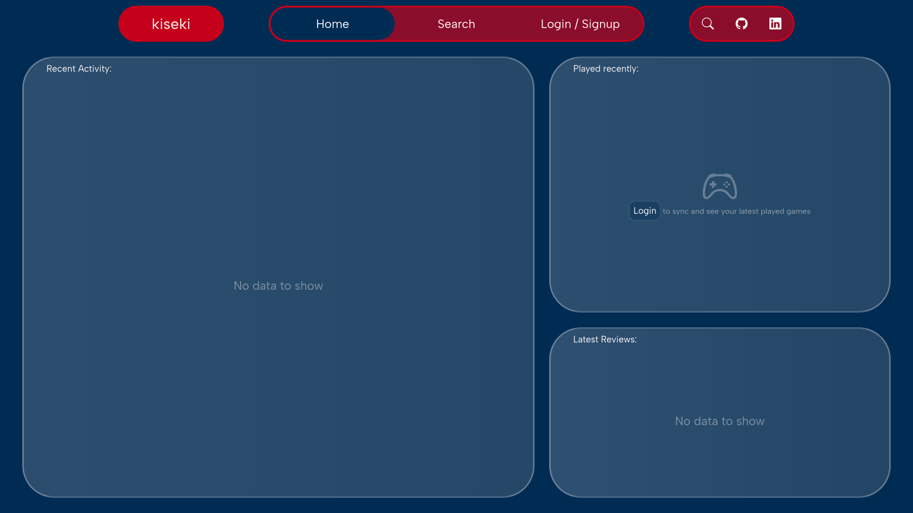
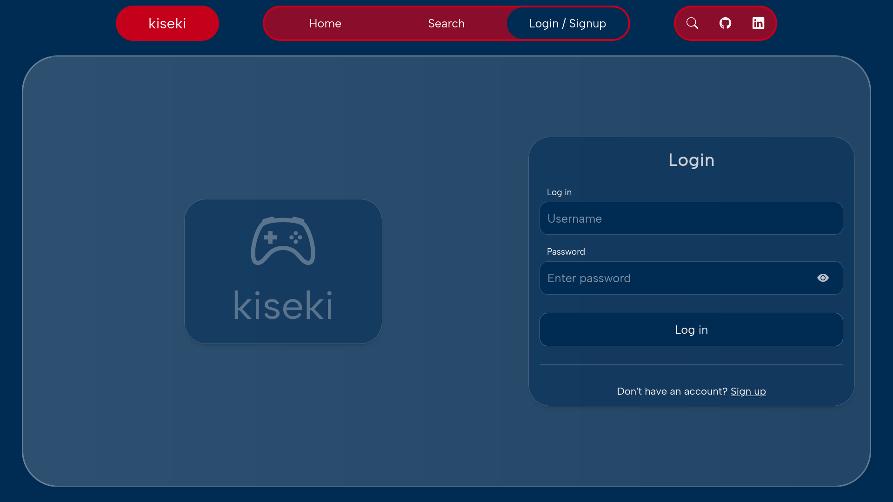
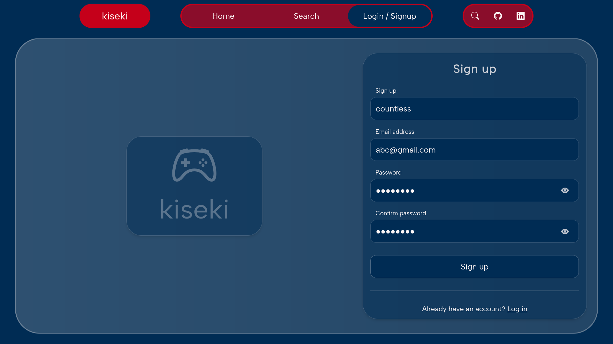
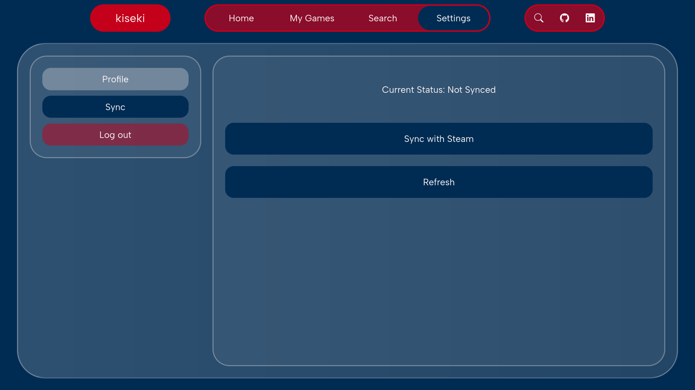
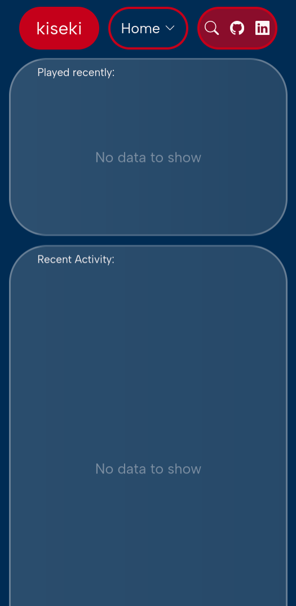
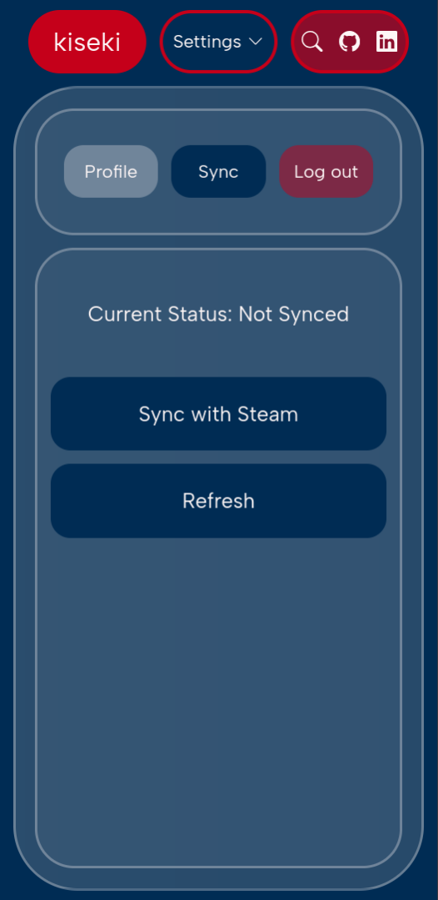

<div align="center">

# kiseki

**A game library and activity tracker with Steam sync — built with Laravel and Livewire.**

[](https://laravel.com)
[](https://livewire.laravel.com)
[](https://tailwindcss.com)
[](https://www.php.net)
[](https://www.sqlite.org)

[Design](#design) · [Screenshots](#screenshots) · [Features](#features) · [Getting started](#getting-started) · [Status](#status)

</div>

---

> **Designed in Figma first.**
>
> Kiseki is a completely handwritten project — every screen, component, and piece of custom styling was written from scratch. No page builders or UI kits were used.

Kiseki is a web app for keeping your Steam library, play activity, and reviews in one place. Create an account, link your Steam profile, and browse your collection from an interface that is designed for both desktop and mobile.

**This is an abandoned work-in-progress.** Account flows, Steam account linking, and the responsive UI were built; persisting and displaying imported game data was left unfinished.

## Design

The UI was designed in Figma before implementation — including desktop and mobile layouts for the home feed, login and signup, the game library, and settings.

**[View the Figma file →](https://www.figma.com/design/NxXbkPgOEJJqzlrlLJFnxb/Kiseki?node-id=356-25&t=8EvLKpjqFqQNcIxm-1)**

<p align="center">
  <a href="https://www.figma.com/design/NxXbkPgOEJJqzlrlLJFnxb/Kiseki?node-id=356-25&t=8EvLKpjqFqQNcIxm-1">
    
  </a>
</p>

## Screenshots

These are screenshots of the implemented application.

### Desktop

| Home | Log in |
|:---:|:---:|
| [](docs/images/home-desktop.png) | [](docs/images/login-desktop.png) |
| **Home** — activity feed, recently played games, and latest reviews | **Log in** — account authentication and validation |

| Sign up | Settings → Sync |
|:---:|:---:|
| [](docs/images/signup-desktop.png) | [](docs/images/settings-desktop.png) |
| **Sign up** — validation, password hashing, and automatic login | **Settings** — profile/sync tabs, Steam linking, and logout |

### Mobile

| Home | Settings → Sync |
|:---:|:---:|
| <a href="docs/images/home-mobile.png"></a> | <a href="docs/images/settings-mobile.png"></a> |

## Features

- **Figma-driven design system** — custom colors, spacing, and radii defined as Tailwind theme tokens, with separate desktop and mobile layouts.
- **Authentication** — sign up and log in with validation, hashed passwords, session regeneration, and guest/auth route protection.
- **Steam account linking** — Steam OpenID flow through Laravel Socialite, with the linked Steam ID stored per user and owned games fetched from the Steam Web API.
- **Livewire navigation** — fast page transitions with `wire:navigate`, no full-page reloads, and Alpine.js for local UI interactions.
- **Reusable Blade components** — gradient containers, navbar, auth layout, buttons, and text components shared across every page.
- **Settings** — profile and sync tabs, sync status, Steam connection, and logout.
- **Responsive by design** — layouts are designed and implemented for both large screens and narrow mobile viewports.
- **Portable database** — SQLite by default for zero-config local development, with MySQL support.

## Tech stack

| Area | Technology |
| --- | --- |
| Backend | PHP 8.2+, Laravel 12 |
| UI | Livewire 3, Blade, Alpine.js |
| Styling | Tailwind CSS 4, Bootstrap Icons |
| Authentication | Laravel session auth, Laravel Socialite + Steam provider |
| Build tooling | Vite 6, npm |
| Database | SQLite (default), MySQL |
| Testing | Pest 3 |

## Getting started

### Requirements

- PHP 8.2 or newer with the `pdo_sqlite` extension
- [Composer](https://getcomposer.org)
- Node.js 20+ and npm

### Installation

```bash
git clone <your-repository-url> kiseki
cd kiseki

composer install
npm install

cp .env.example .env
php artisan key:generate
```

Set the URL used by the local server and by the Steam redirect:

```dotenv
APP_URL=http://localhost:8000
```

Create the SQLite database:

```bash
touch database/database.sqlite
```

Make sure your `.env` uses SQLite:

```dotenv
DB_CONNECTION=sqlite
# DB_DATABASE=/absolute/path/to/database/database.sqlite
```

If `DB_DATABASE` is left unset, Laravel uses `database/database.sqlite`. If you set it, use an absolute path. A bare value such as `kiseki` is treated as a file path and creates a database file in the current directory, not a database named "kiseki".

Run the migrations and start the development environment:

```bash
php artisan migrate
composer dev
```

`composer dev` starts the Laravel server, the queue listener, and Vite together. The app is available at [http://localhost:8000/home](http://localhost:8000/home).

### Using MySQL instead

Replace the database block in `.env` with your MySQL credentials:

```dotenv
DB_CONNECTION=mysql
DB_HOST=127.0.0.1
DB_PORT=3306
DB_DATABASE=kiseki
DB_USERNAME=root
DB_PASSWORD=
```

Then run `php artisan migrate`.

### Steam integration

The Steam link flow needs a Steam Web API key:

1. Get a key at [steamcommunity.com/dev/apikey](https://steamcommunity.com/dev/apikey).
2. Add it to `.env`:

```dotenv
STEAM_CLIENT_SECRET=your_steam_web_api_key
```

3. Link a Steam account from **Settings → Sync → Sync with Steam**.

Your Steam profile must be public for the owned-games request to return data.

## Project structure

```text
app/
├── Http/Controllers/SteamAuthManager.php   # Steam OpenID callback + owned-games request
├── Livewire/                               # Page components: Home, Login, Signup, Settings, My Games...
└── Models/                                 # User, Games, Syncs

resources/
├── css/app.css                             # Tailwind import, design tokens, shared utilities
├── js/                                     # Vite entry point and Bootstrap
└── views/
    ├── components/                         # Reusable Blade UI components
    └── livewire/                           # Page templates

database/
├── migrations/                             # Users, games, syncs, cache, jobs, tokens
└── database.sqlite                         # Local SQLite database (gitignored)

routes/web.php                              # Public pages, settings, and Steam auth routes
```

## Status

Kiseki is no longer being developed.

**Completed:**

- [x] Responsive desktop and mobile UI
- [x] Account creation, login, logout, and route protection
- [x] Steam account linking via OpenID
- [x] Steam owned-games API request

**Planned but never finished:**

- [ ] Persist imported Steam games and show them in My Games
- [ ] Recent activity and latest reviews feeds
- [ ] Game search
- [ ] Profile customization (avatar, background, colors)
- [ ] Automated/recurring Steam sync
- [ ] Broader automated test coverage

---

Built with [Laravel](https://laravel.com), [Livewire](https://livewire.laravel.com), and [Tailwind CSS](https://tailwindcss.com). Icons from [Bootstrap Icons](https://icons.getbootstrap.com).
